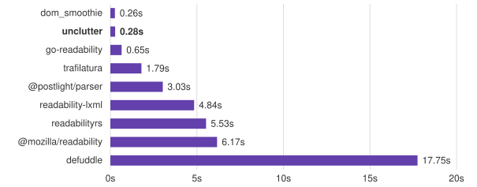

## unclutter

[-brightgreen)](https://github.com/terror/readability/blob/master/tests/integration.rs)

**unclutter** is a Rust port of [mozilla/readability](https://github.com/mozilla/readability).

  <picture align="center">
    <source media="(prefers-color-scheme: dark)" srcset="assets/benchmark-dark.svg">
    <source media="(prefers-color-scheme: light)" srcset="assets/benchmark-light.svg">
    
  </picture>

  <i>Extracting articles from the 130 Mozilla Readability test pages.</i>

